<p align="center">
  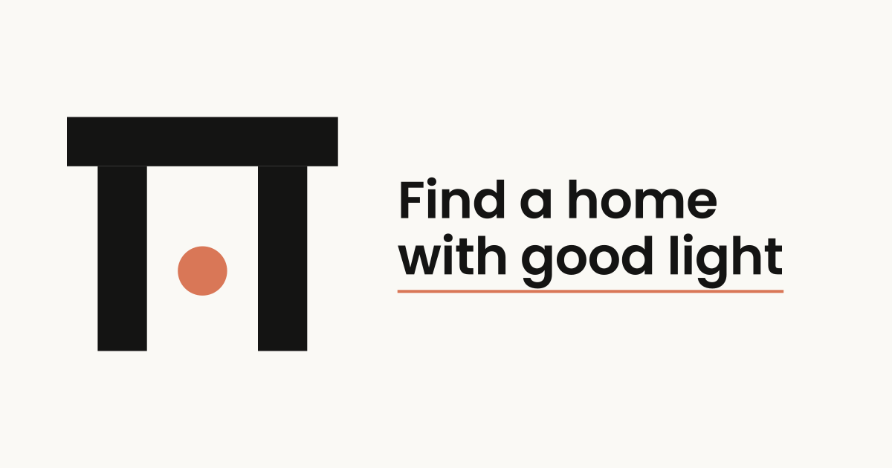
</p>

<h1 align="center">Lintel</h1>

<p align="center">
  A property discovery app for browsing homes, building a shortlist, and comparing
  what you saved. A <em>lintel</em> is the beam that carries the weight above an
  opening — the brand's idea is structure that lets the light in.
</p>

<p align="center">
  
  
  
  
  
</p>

---

## Screens

<table>
  <tr>
    <td align="center" width="25%">
      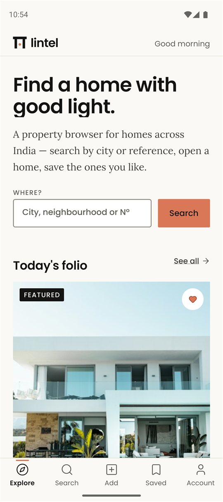<br />
      <sub><b>Home</b><br />Masthead, one-line search, today's folio</sub>
    </td>
    <td align="center" width="25%">
      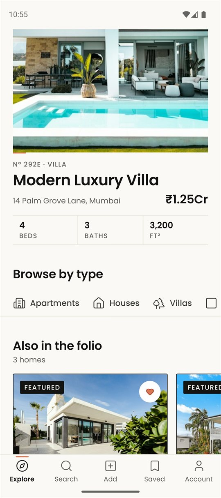<br />
      <sub><b>The folio</b><br />Featured home, browse by type, the rest</sub>
    </td>
    <td align="center" width="25%">
      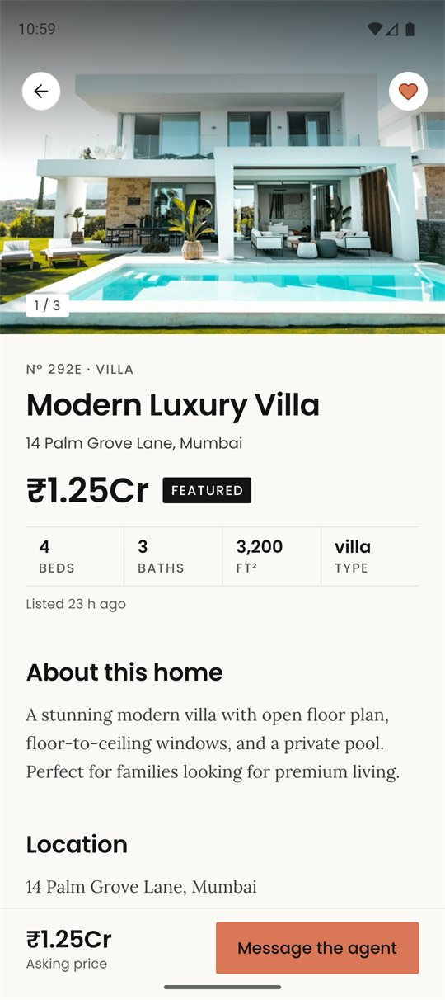<br />
      <sub><b>Detail</b><br />Gallery, specs, save, agent actions</sub>
    </td>
    <td align="center" width="25%">
      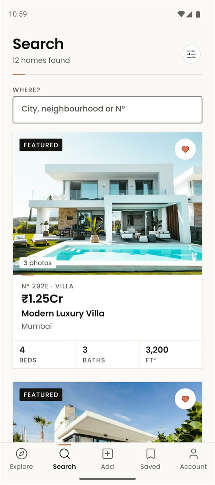<br />
      <sub><b>Search</b><br />Filtered list, specs at a glance</sub>
    </td>
  </tr>
  <tr>
    <td align="center" width="25%">
      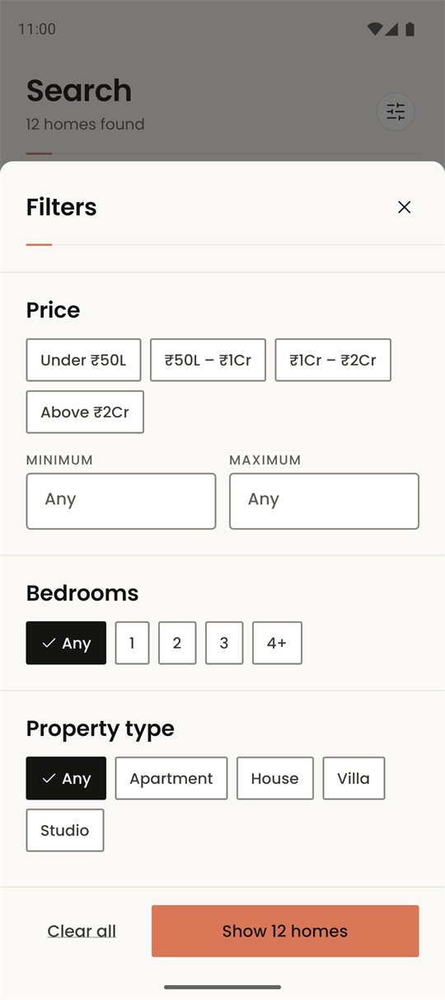<br />
      <sub><b>Filters</b><br />Price bands, type, bedrooms as chips</sub>
    </td>
    <td align="center" width="25%">
      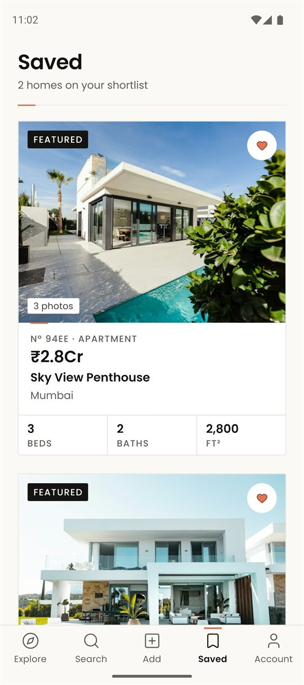<br />
      <sub><b>Saved</b><br />The shortlist, synced to the account</sub>
    </td>
    <td align="center" width="25%">
      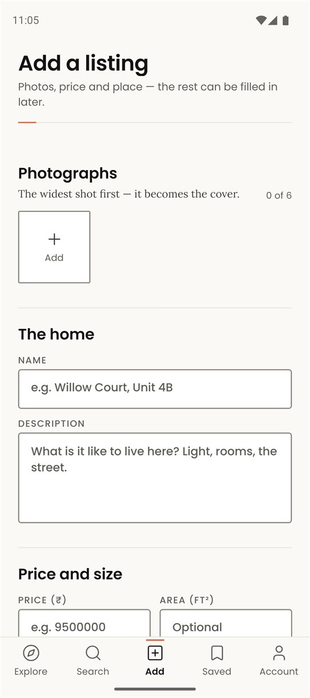<br />
      <sub><b>Add a listing</b><br />Photos, price and place — agents only</sub>
    </td>
    <td align="center" width="25%">
      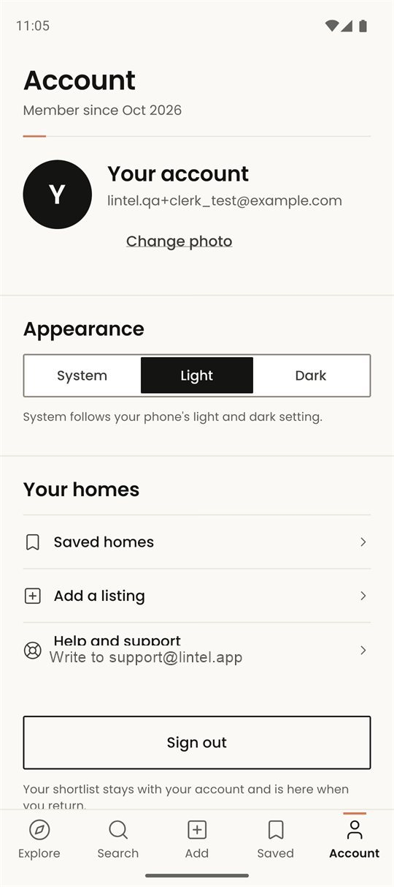<br />
      <sub><b>Account</b><br />Identity, appearance, sign out</sub>
    </td>
  </tr>
  <tr>
    <td align="center" width="25%">
      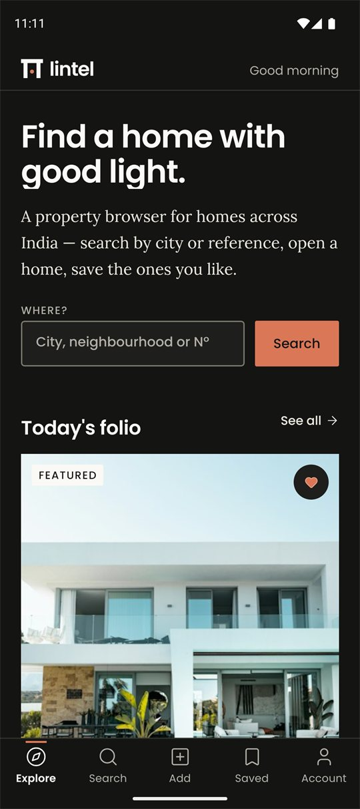<br />
      <sub><b>Home</b> · dark</sub>
    </td>
    <td align="center" width="25%">
      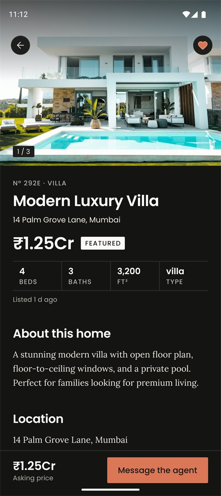<br />
      <sub><b>Detail</b> · dark</sub>
    </td>
    <td align="center" width="25%">
      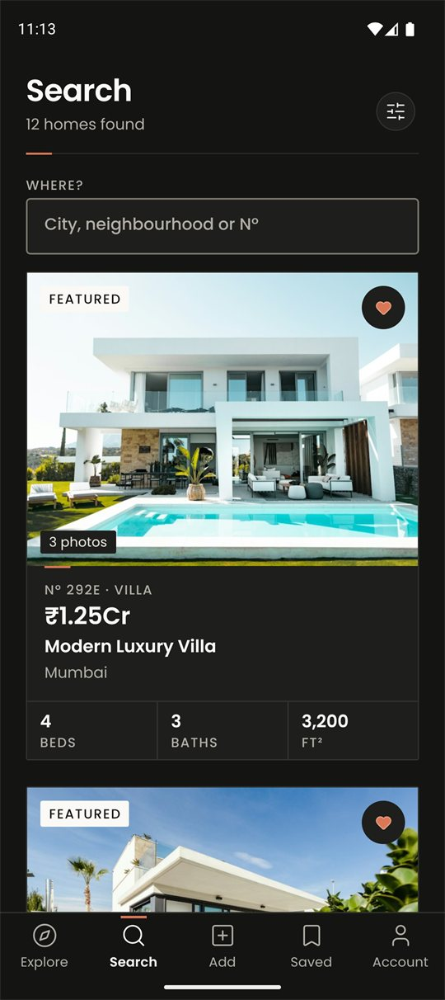<br />
      <sub><b>Search</b> · dark</sub>
    </td>
    <td align="center" width="25%">
      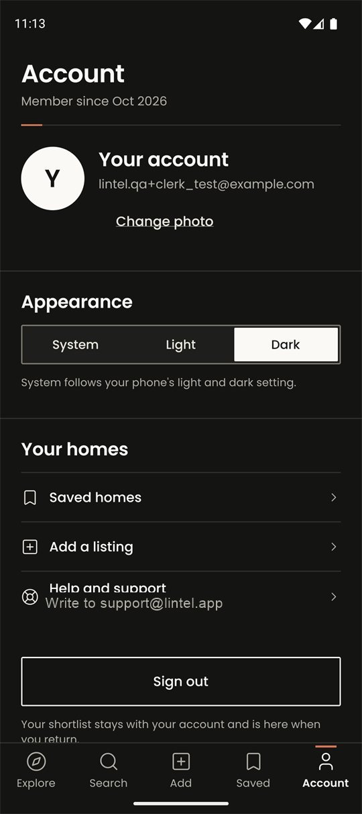<br />
      <sub><b>Account</b> · dark</sub>
    </td>
  </tr>
</table>

<p align="center"><sub>Captured on a Pixel 9 emulator (Android 15, API 35) from a release build — no dev overlay.</sub></p>

---

## What it does

- **Discover** — a folio of featured homes plus a browse-by-type rail, read from a
  public catalogue in Postgres.
- **Search** — filter by city, reference number, price band, property type and
  bedroom count; the query runs against Supabase rather than filtering in memory.
- **Compare** — a detail screen with a full-bleed gallery and lightbox, specs in a
  hairline table, and a full-screen map when the listing has a pin.
- **Shortlist** — save and unsave with an optimistic toggle that rolls back if the
  write fails, so the heart never lies about what was stored.
- **Publish** — the middle tab is conditional. Agents get it; everyone else gets
  four destinations and never sees the form.
- **Belong to a person** — Clerk owns the session, Supabase scopes the rows.

## Stack

| Layer          | Choice                                                    |
| -------------- | --------------------------------------------------------- |
| Runtime        | Expo SDK 58 · React Native 0.88 · React 19.3              |
| Language       | TypeScript 6 (strict) · React Compiler enabled             |
| Routing        | Expo Router 58 — file-based, typed routes, headless tabs   |
| Auth           | Clerk (`@clerk/expo`) with a SecureStore token cache       |
| Data           | Supabase Postgres + row-level security                     |
| Client state   | Zustand 5 (filters, user)                                  |
| Styling        | Design tokens + `StyleSheet`; Poppins (display) & Lora (reading) |
| Motion         | Reanimated 4 · Gesture Handler 3                           |
| Media          | `expo-image`, `expo-image-picker`, `react-native-svg`       |
| Maps           | `react-native-webview` with an OpenStreetMap embed          |
| Build          | Expo CNG (prebuild) → Gradle locally, or EAS in the cloud   |

<sub>NativeWind is present but is not the styling path: it supplies the colour-scheme channel and `global.css`, while every visual value comes from a token.</sub>

## Architecture

<p align="center">
  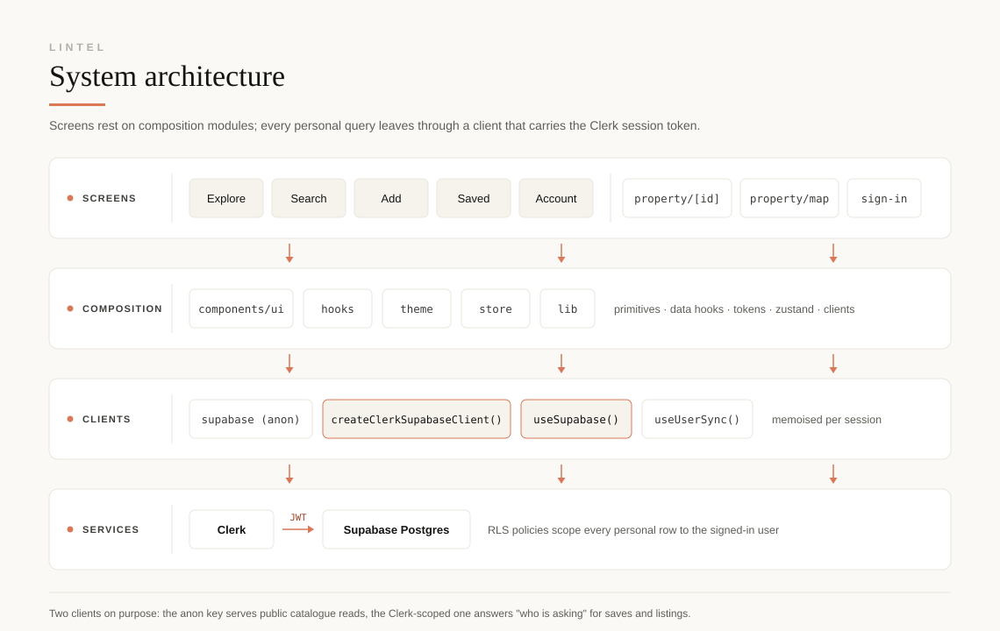
</p>

### The route tree is the gate

```
src/app/
  _layout.tsx          boot: fonts, splash, Clerk, theme, gesture + safe-area roots
  index.tsx            the one redirect — session ? tabs : sign-in
  (auth)/              sign-in, sign-up
  (root)/
    _layout.tsx        auth gate + user sync
    (tabs)/            Explore · Search · Add · Saved · Account
    property/[id].tsx  detail
    property/map.tsx   full-screen pin
```

`(root)/_layout.tsx` decides once, and mounts nothing else when signed out:

```tsx
const { isSignedIn, isLoaded } = useAuth();
useUserSync();

if (!isLoaded) return null;              // Clerk is still restoring the session
if (!isSignedIn) return <Redirect href="/sign-in" />;
```

There is no redirect effect and no flash of the wrong screen: while the session is
being restored the shell renders nothing at all, and the native splash is still up.

### Two Supabase clients, on purpose

A public catalogue and a person's shortlist need different answers to "who is
asking", so `src/lib/supabase.ts` exports both:

```ts
export const supabase = createClient(supabaseUrl, supabaseAnonKey);

export function createClerkSupabaseClient(getToken: () => Promise<string | null>) {
  return createClient(supabaseUrl, supabaseAnonKey, {
    async accessToken() {
      return getToken();               // the Clerk JWT rides on every request
    },
  });
}
```

`useSupabase()` memoises the second one against the session, so the token is
always current and the client is never cached past it. Public reads go through
the anon client; saves, publishes and admin edits go through the token-bearing
one, and Postgres decides.

1. `ClerkProvider` restores the session from `expo-secure-store`.
2. `useUserSync()` mirrors the user into `users` and reads `is_admin` into Zustand.
3. `useSupabase()` wraps `getToken()` in a client whose `accessToken` callback is
   invoked per request.
4. Postgres matches the caller against `user_clerk_id` on `saved_properties`, and
   the token's absence is what keeps the catalogue read-only for visitors.

### Conventions

- Nothing in `src/components` imports from `src/app` — routes depend on
  components, never the reverse.
- Every visual value is a token (`src/theme/tokens.ts`). No component hard-codes a
  hex, a px, a radius or a duration.
- Tables touched: `properties`, `saved_properties`, `users`.

## Project structure

```
src/
  app/                      routes only — every file here is a screen
  components/
    ui/                     19 primitives: button, chip, screen, text-field, lightbox, …
    app-tabs.tsx            headless tab bar (expo-router/ui)
    property-card.tsx       the list row
    featured-card.tsx       the large folio card
    filter-modal.tsx        the filter sheet
    auth/                   shared credential-screen scaffold
  hooks/                    7: supabase, saved-property, user-sync, theme, motion, breakpoints, deferred-flag
  lib/                      supabase clients, small utilities
  store/                    zustand: filters, user
  theme/                    tokens, light/dark palettes, motion, navigation theme, provider
  types/                    Property, SavedProperty, PropertyDraft
docs/                       architecture diagram + screenshots
lintel-brand-kit/           logo system, app icons, favicons, banners
```

## Getting started

Requires Node 20+ and either an Android/iOS emulator or a device.

```bash
npm install

# .env.local — three values, all inlined at build time
# EXPO_PUBLIC_CLERK_PUBLISHABLE_KEY=pk_…
# EXPO_PUBLIC_SUPABASE_URL=https://<project>.supabase.co
# EXPO_PUBLIC_SUPABASE_KEY=ey…          (the anon key)

npx expo start
```

| Variable                            | Needed | Read by                                            |
| ----------------------------------- | ------ | -------------------------------------------------- |
| `EXPO_PUBLIC_CLERK_PUBLISHABLE_KEY` | yes    | `src/app/_layout.tsx` — boot fails with a message naming it |
| `EXPO_PUBLIC_SUPABASE_URL`          | yes    | `src/lib/supabase.ts`                              |
| `EXPO_PUBLIC_SUPABASE_KEY`          | yes    | `src/lib/supabase.ts` — the anon key                |

The anon key ships in the bundle by design; row-level security, not secrecy, is
what protects the data. `CLERK_SECRET_KEY` is **not** read anywhere in this app —
only add it if you introduce server-side Clerk calls.

`android/` and `ios/` are generated by Expo CNG and are gitignored. From a fresh
clone, `npm run android` prebuilds them; to force a clean regeneration use
`npx expo prebuild --clean`.

## Scripts

| Command                            | What it does                                |
| ---------------------------------- | ------------------------------------------- |
| `npm start`                        | Dev server (Metro + Expo Router)            |
| `npm run android`                  | Prebuild, build and install a debug build   |
| `npm run ios`                      | Same, for iOS                               |
| `npm run web`                      | Dev server targeting the web                |
| `npm run lint`                     | ESLint (`eslint-config-expo`)                |
| `npm run typecheck`                | `tsc --noEmit`                              |
| `npx expo run:android --variant release` | A signed release APK, bundle included  |
| `npx expo-doctor`                  | Dependency and config audit                 |

## Quality gates

All three checks pass on the current tree, and a release build completes locally:

```bash
npm run typecheck    # clean
npm run lint         # clean
npx expo-doctor      # clean
npx expo run:android --variant release
```

The release build is what the screenshots above come from: 4,212 modules bundled,
35 asset files, 679 Gradle tasks, `BUILD SUCCESSFUL`. There is no automated test
suite yet — the gate is typecheck, lint, doctor, plus a manual pass over every
screen in both themes.

## Design — "Daylight Folio"

Paper and ink with a single ember accent. Poppins carries structure, Lora carries
reading. Hairline rules instead of boxes, 44 px touch targets, and motion that only
ever touches `transform` and `opacity`.

Every value lives in `src/theme/tokens.ts` — a 4 px spacing scale, a type ramp, a
radius and border-width set, and two hand-tuned palettes rather than a filtered
tint of one. `DESIGN.md` is the source of truth for the system, including the
contrast ratios; the app follows it rather than the other way round.

The app icon, splash mark and in-app wordmark are one drawing at three sizes: the
symbol is geometry from the brand kit (`components/ui/lintel-mark.tsx`), so it
stays crisp and follows the theme. `lintel-brand-kit/` holds the full source
system — logos, Android adaptive layers, favicons and banners.

## Roadmap

- An automated test suite (the current gate is static analysis plus a device pass).
- Map pins for listings that have no `latitude`/`longitude` yet.
- The map's empty state still uses a local layout instead of the shared `EmptyState`.

## License

MIT — see [LICENSE](LICENSE).
